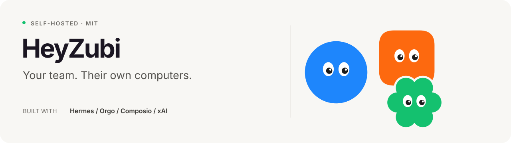
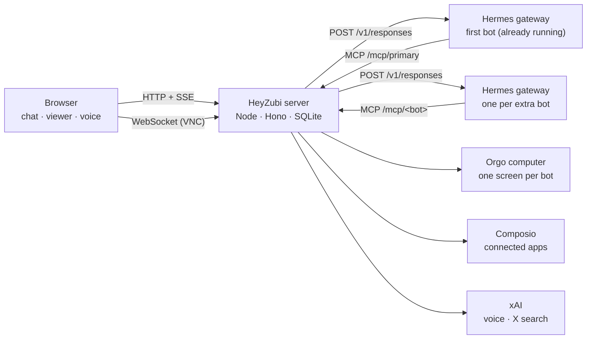

<p align="center">
  
</p>

<p align="center">
  A team of AI agents you chat with, each with its own screen on one computer: an Orgo cloud computer, or your own server with local screens.<br>
  <a href="https://github.com/NousResearch/hermes-agent">Hermes Agent</a> runs the bots, <a href="https://orgo.ai">Orgo</a> (or your own server) gives them screens, <a href="https://composio.dev">Composio</a> connects their apps, and <a href="https://x.ai">xAI</a> gives them a voice and research on X.
</p>

<p align="center">
  <a href="#what-you-get">What you get</a> ·
  <a href="#how-it-fits-together">How it works</a> ·
  <a href="#install-on-the-computer">Install</a> ·
  <a href="#run-it-locally">Run locally</a> ·
  <a href="docs/ARCHITECTURE.md">Architecture</a> ·
  <a href="#status-and-limits">Limits</a> ·
  <a href="SECURITY.md">Security</a> ·
  <a href="#disclaimer">Disclaimer</a>
</p>

<p align="center">
  
  
  
</p>

<p align="center">
  <picture>
    <source media="(prefers-color-scheme: dark)" srcset="assets/screenshots/chat-dark.png">
    
  </picture>
</p>

---

Give a bot a job, connect the apps it needs, and follow its work in chat. Each bot has a name, a look, its own memory, and a screen you can watch or take over. Bots can message each other, run recurring tasks, and talk with you over voice.

Every bot is a Hermes agent, so it can run on the model subscriptions you already pay for (Claude, ChatGPT, Grok and others) or on API keys.

> HeyZubi is a fork of [Bot HQ](https://github.com/nickvasilescu/bot-hq) by Nick Vasilescu, rebranded and extended to run without Orgo. It is an independent, unofficial open-source project. It is not affiliated with, endorsed by or sponsored by xAI, Nous Research, Composio or the other third-party companies named here. See the [disclaimer](#disclaimer).

## What you get

| | |
|---|---|
| **Chat that shows the work** | While a bot works you see what it is doing right now, how long it has been at it, and each step it took. Finished turns fold into a "Worked for 2m 10s · 7 steps" chip you can open. |
| **A screen per bot** | Every bot has its own desktop on the shared computer. Watch it live in the side panel, open it full size, or take control with your own mouse and keyboard. |
| **Your existing Hermes agent, kept as it is** | The first bot is the Hermes agent already running on the computer. Its messaging channels, skills and memory keep working; the app only calls its API. |
| **Connected apps with approvals** | Bots ask for the app they need and you connect it through Composio. Every action in a connected app, reading included, waits for your OK on a card in the chat until you choose **Always allow** for it. |
| **Model and subscription per bot** | Pick the provider and model in the bot's Engine panel, or sign in to a subscription on the bot's own screen. |
| **Voice** | Talk to a bot with xAI's realtime voice modes. Real work is handed to the same bot, with the same memory and tools. |
| **Research on X** | Every bot has an `x_search` tool, backed by xAI. |
| **Routines, tasks and a Library** | Recurring jobs on a schedule, a task list per bot, and a place where bots save the files they make. |


<sub>The screenshot at the top shows the sample data built into the dev server (add <code>?fixtures</code> to the URL).</sub>

## How it fits together



- **One computer, one screen per bot.** All bots live on a single Orgo Linux computer. The owner's first bot uses the computer's main screen; every other bot gets an Orgo screen of its own. Orgo allows four screens per computer, so four bots.
- **The owner's first bot is the Hermes agent that already runs on that computer.** No other account's bot is ever bound to it. The app talks to its gateway and never restarts it or rewrites its settings.
- **Every other bot gets its own Hermes home and gateway**, started by the app. Each has its own model, sign-in, memory, browser profile and files.
- **The app's tools reach Hermes over MCP.** The server exposes `/mcp/<bot>`. Each agent gets connected apps, `x_search`, tasks, routines, the Library, and messages to other bots.
- **Screens are dressed to look like the bot's own computer**: a light desktop with a dock, and a home screen with the bot's name and apps as Chrome's new tab page.

More detail is in the [architecture guide](docs/ARCHITECTURE.md).

### How this relates to Hermes Bot Mode

Hermes Desktop has its own Bot Mode. HeyZubi uses the same Hermes engine but does **not** use Bot Mode: it has its own bot layer on top of the gateway's HTTP API.

| | HeyZubi | Hermes Bot Mode |
|---|---|---|
| A bot is | A separate Hermes home (the first bot is the default profile) | A Hermes profile |
| Gateways | One per extra bot | One, serving every profile |
| Transport | HTTP, `/v1/responses` | JSON-RPC over WebSocket |
| Routines | The app's own scheduler | Hermes cron jobs |
| Bot to bot | The app's `send_to_bot` tool | Hermes' `message_agent` tool |

So bots made here do not show up in Hermes Desktop's Bots tab, and bots made there do not show up here.

## Install on the computer

The app is meant to run on the same computer as Hermes: an Orgo computer (below), or your own server where Hermes runs in Docker, with local screens instead of Orgo (`HQ_SCREENS=local`, see [deploy/hermes-box](deploy/hermes-box/README.md)).

1. On your machine: `npm ci && scripts/pack.sh hq-app.tgz`. Copy `hq-app.tgz` and `scripts/install-on-computer.sh` to the computer.
2. In Orgo, create a public URL for port `8787` on that computer.
3. On the computer, as root:

   ```bash
   PUBLIC_URL=https://<name>.orgo.dev ORGO_COMPUTER_ID=<uuid> ALLOWED_EMAILS=you@example.com OWNER_EMAIL=you@example.com \
   KEYS_FILE=/root/keys.txt PRIMARY_CDP_URL=http://127.0.0.1:9333 \
     bash install-on-computer.sh hq-app.tgz
   ```

   `KEYS_FILE` holds `XAI_API_KEY=` and `COMPOSIO_API_KEY=` lines (and `ORGO_API_KEY=` if Hermes' own `.env` has none); it is deleted after the first install. `OWNER_EMAIL` is your own account: its first bot is the agent that already runs on the computer, with that agent's memory, messaging and main screen, and nobody else's bot ever is (left out, it is the first address in `ALLOWED_EMAILS`). `PRIMARY_CDP_URL` is only for a main agent that already has its own Chrome. The script installs to `/opt/hq`, adds one supervisor program (`hq-app`), and leaves Hermes alone. Running it again with a newer `hq-app.tgz` upgrades the app and keeps its settings and data.
4. Give the main agent the app's tools: `python3 /opt/hq/app/scripts/add-hq-to-hermes.py`. It adds one `mcp_servers.hq` entry to Hermes' `config.yaml`, keeps a dated copy of the file, and Hermes picks the change up without a restart. `--remove` takes it out again.
5. Open the public URL and sign in with Google. If Google sign-in is not set up yet, `bash /opt/hq/app/scripts/sign-in-link.sh you@example.com` on the computer prints a one-time sign-in link.

<details>
<summary><b>Remove everything</b></summary>

On the computer:

```bash
python3 /opt/hq/hq-screen.py undress 99                      # main screen back to how it was (99 = its X display)
python3 /opt/hq/app/scripts/add-hq-to-hermes.py --remove     # take the tools out of Hermes
supervisorctl stop hq-app && supervisorctl remove hq-app
rm -rf /etc/supervisor/conf.d/hq-app.conf /opt/hq /var/log/hq /root/heyzubi /root/bothq /root/grokbot /etc/opt/chrome/policies/managed/hq.json
```

Then delete the public URL in Orgo. Screens of the other bots are released when you delete those bots in the app.

</details>

## Upgrading

Run the install script again with a newer `hq-app.tgz`; settings and data are kept. Two things to know when coming from an older version:

- **Sign-in is stricter.** The server refuses to start with the example `SESSION_SECRET`. On a public URL only addresses in `ALLOWED_EMAILS` can sign in or stay signed in: an empty list lets nobody in, and an account that is not on the list is signed out even if it signed in before. `DEV_LOGIN` only works on `localhost`. `scripts/sign-in-link.sh` still signs anyone in from the computer itself, and that sign-in is kept whatever the list says.
- **The computer's own agent goes to the owner only.** The first bot anyone created used to be bound to the agent that already runs on the computer. Now only a bot of `OWNER_EMAIL` is. An existing install has no `OWNER_EMAIL` until you run the install script again with `OWNER_EMAIL=<your address>`; until then no new bot gets that agent. A bot that already holds it keeps it, whoever it belongs to, and the server names it in a warning at start-up. Nothing is moved for you: to free the agent, delete that bot from its own account (`scripts/sign-in-link.sh <that address>` signs you in as it), and the owner's next new bot gets it.
- **Bots ask before every app action.** Actions whose name sounded read-only (get, list, search, fetch and the like) used to run without asking; now each asks the first time, as do Composio's sandbox tools. Choose **Always allow** on the card for the ones you trust. Choices you made before are kept. A routine that runs while nobody is there waits for its card (up to 25 minutes) and is skipped if it is not answered, so allow what your routines use.
- **Sign-in attempts are limited per address.** Ten Google sign-in starts (and ten dev sign-ins) in ten minutes, and five wrong sign-in links or owner keys; after that the route answers 429 until the ten minutes have passed. The count is by connecting address, so behind a forwarder that connects from one address it is shared by everyone, and it starts again when the server restarts.
- **`/mcp` and the owner sign-in only answer on the computer itself.** A call has to come from a loopback address and must not have been passed on by a proxy. The defaults already work this way (`MCP_BASE_URL` is `http://127.0.0.1:<port>`, and `scripts/sign-in-link.sh` calls `127.0.0.1`); an agent that reaches `/mcp` through the public URL or from another machine or container is refused with a 403.
- **The project used to be called "Bot HQ", and before that "Grokbot".** Old names keep working: `HEYZUBI_*` environment variables are read first, then `BOTHQ_*`, then `GROKBOT_*`; an existing `data/bothq.db` or `data/grokbot.db` stays the default database; a computer that has `/root/bothq` or `/root/grokbot` keeps using it for browser profiles and Library files; and sign-in cookies and browser settings saved under the old names are still read, so nobody is signed out and no setting is lost.

## Run it locally

You need **Node.js 22 or newer** and a Hermes gateway with its API server on (`API_SERVER_KEY` in `~/.hermes/.env`).

```bash
git clone https://github.com/themonkmarketer-cpu/heyzubi-live.git
cd heyzubi-live
npm ci
cp .env.example .env      # fill in the keys; comments in the file explain each one
npm run dev -w server     # API on :8787
npm run dev -w web        # app on :5173
```

With `HQ_LOCAL=0` the server reaches the computer through the Orgo API instead of running commands on it, which is enough for development. `DEV_LOGIN=1` enables the email-only sign-in form; it only works while `APP_URL` is a `localhost` address, and only for requests from the same machine. While `APP_URL` is a `localhost` address the server also listens on `127.0.0.1` only; set `HOST` (for example `HOST=0.0.0.0`) to reach it from another device. Before you put the app on a public URL, read [SECURITY.md](SECURITY.md).

`npm run build && npm start` serves the built app from the API port.

The keys you need:

| Key | Used for |
|---|---|
| `ORGO_API_KEY`, `ORGO_COMPUTER_ID` | The computer and its screens |
| `COMPOSIO_API_KEY` | Connected apps |
| `XAI_API_KEY` | Voice and `x_search` |
| `SESSION_SECRET` | Sign-in sessions and the tokens agents use to reach `/mcp`. Use a long random value (`openssl rand -hex 32`); the server refuses the placeholder |

## Models and subscriptions

Open a bot's details panel, **Engine**. Pick a provider and model there. **Sign in to a subscription** opens a terminal on the bot's screen running Hermes' own sign-in for that provider (for example Claude Pro/Max), so you finish it in the viewer and the bot uses that subscription from then on. Check your provider's terms before running an agent on a consumer subscription.

## Development

```bash
npm run typecheck       # server and web
npm run build
node tests/security.mjs # sign-in and access checks; run after the build, needs no keys
node tests/e2e.mjs https://<your-url>    # needs E2E_SESSION=<session cookie> (DEV_LOGIN=1 works only against localhost)
```

The security checks start a throwaway copy of the built server on this machine, with made-up keys, a temporary database and a stand-in for Composio, and call nothing outside it. The e2e suite creates a temporary bot (with its own Hermes gateway and screen), exercises chat, the browser on its screen, the live viewer, connected apps, voice sessions and settings, then deletes it. It calls real providers.

```text
server/src/         API, Hermes adapter (agent/loop.ts), engines (engine.ts), MCP endpoint (mcp.ts), screens (computer.ts)
server/box/         what runs on the computer to dress a screen (desktop, dock, home screen, Chrome)
web/src/            chat, bot settings, app connections, computer viewer, voice
scripts/            pack, install, Hermes config helper, sign-in link
tests/              security checks (no keys needed), Playwright end-to-end test
docs/               architecture; the Orgo and xAI/Composio guides predate the Hermes engine
```

## Status and limits

- Experimental. Bots share one computer, run as root and can reach each other's files there. Read [SECURITY.md](SECURITY.md) before deploying.
- Approval cards cover what a bot does in connected apps through Composio. What a bot does through its browser or shell is not gated, and Hermes' own "risky command" prompts are not shown in the app yet.
- Four bots at most, because of Orgo's four-screen limit.
- The screen look is an original implementation inspired by OrgoAI/bops; no code or assets from that repository are used.

## License and credits

Available under the [MIT license](LICENSE). The bot characters, icons and screenshots in this repository were made for the project (icons from [Lucide](https://lucide.dev)); app logos are loaded at runtime and belong to their owners. See [third-party notices](THIRD_PARTY_NOTICES.md).

HeyZubi is a fork of [Bot HQ](https://github.com/nickvasilescu/bot-hq) by Nick Vasilescu, which grew out of [Orgo Teammates](https://github.com/nickvasilescu/orgo-teammates). The HeyZubi brand (name, Zubi mascot, colours and type) comes from the HeyZubi brand guide. Built with [Hermes Agent](https://github.com/NousResearch/hermes-agent) (MIT), [Orgo](https://orgo.ai), [Composio](https://composio.dev), and the [xAI API](https://x.ai).

## Disclaimer

- **Independent and unofficial.** HeyZubi is an independent open-source project. It is not affiliated with, endorsed by or sponsored by xAI, X Corp, SpaceX, Meta, OpenAI, Anthropic, Google, Cursor/Anysphere, Nous Research, Composio, or any other company or product named in this repository, apart from Orgo (Organic Intelligence, Inc.), which the original Bot HQ author co-founded. Third-party names are trademarks of their respective owners and are used only to describe compatibility. Hermes Agent is used under its MIT license.
- **Written from scratch.** This project was written from scratch and contains no code, assets, prompts or other material from xAI's products. It talks only to public, documented APIs, using your own keys.
- **Educational and experimental.** It is provided "as is", without warranty of any kind, under the [MIT license](LICENSE). Expect bugs and breaking changes.
- **You are responsible for how you use it.** That includes your API keys and the costs they incur, complying with the terms of service of every provider you connect (model providers, Orgo, Composio, X and the apps your bots use) and with applicable law, and supervising agents that act on real accounts. Bots can send messages, spend money and change data on your behalf.
